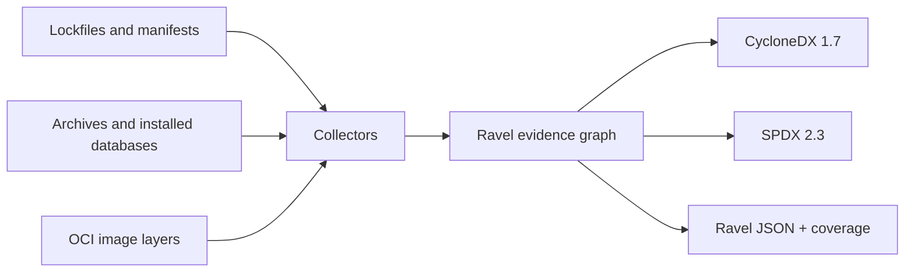

# Ravel

**SBOM generation grounded in evidence from projects, archives, and container images.**

[](https://github.com/Pirikara/Ravel/actions/workflows/ci.yml)

Ravel is a command-line tool under active development, written in Go. It turns local lockfiles, package metadata, archives, and OCI images into a software bill of materials (SBOM). Every package and relationship can carry evidence, while a separate coverage report explains what the input could not establish.

Ravel distinguishes **package identity**, **distribution origin**, and **development repository**. A repository URL in a lockfile is a declaration; it is not proof that a package was downloaded from that URL. When an input cannot establish a claim, Ravel leaves it open instead of inventing one.

- **Outputs:** CycloneDX 1.7 JSON, SPDX 2.3 JSON, Ravel JSON, and a coverage report.
- **Inputs:** common application lockfiles, selected package manager results, package archives, installed OS databases, and local OCI or Docker save archives.
- **Default behavior:** local, static analysis without package manager execution or network access.
- **Inspection:** `explain` a package, `diff` two scans, `merge` scans, or explicitly `enrich` development repository candidates.

> Ravel is under active development. Read the coverage report before treating an SBOM as complete for your use case.

## Contents

- [Get started](#get-started)
- [How Ravel represents evidence](#how-ravel-represents-evidence)
- [Supported inputs](#supported-inputs)
- [Scan workflows](#scan-workflows)
- [Coverage and output formats](#coverage-and-output-formats)
- [Optional resolution and enrichment](#optional-resolution-and-enrichment)
- [Current limits](#current-limits)
- [Development](#development)

## Get started

Ravel currently builds from source and requires **Go 1.27 or newer**.

```sh
go build -o ravel ./cmd/ravel
./ravel scan path/to/project --output sbom.cdx.json --report coverage.json
```

The scan command produces a CycloneDX SBOM and a separate JSON coverage report. To retain evidence and conditional dependency edges for inspection, also write Ravel JSON:

```sh
./ravel scan path/to/project --format ravel-json --output scan.ravel.json
./ravel explain 'package-name' --input scan.ravel.json
```

`scan` accepts either a project directory or a supported file. It writes CycloneDX JSON to stdout unless `--output` is given. Progress and errors go to stderr. Run `./ravel` without arguments for command syntax.

### A small example

The repository includes an RPM database with two test packages. Scan it and inspect the report:

```sh
./ravel scan testdata/fixtures/rpm-sqlite-basic \
  --manager rpm \
  --output rpm.cdx.json \
  --report rpm.coverage.json
```

The report records two packages, their verified dependency, and the remaining origin limit:

```json
{
  "manager": "rpm",
  "graphState": "complete_for_scope",
  "originState": "partial",
  "packages": 2,
  "edges": 3,
  "issues": [
    {"code": "missing_source", "name": "RPM database"}
  ],
  "outputFormat": "cyclonedx-json",
  "outputLosses": [
    {"code": "edge_kinds_omitted", "count": 3},
    {"code": "evidence_records_omitted", "count": 5},
    {"code": "source_paths_omitted", "count": 1},
    {"code": "coverage_issues_omitted", "count": 1}
  ]
}
```

The three Ravel edges include two installed-package edges and one dependency whose RPM version constraint is verified from the installed database's flags and version tags. The dependency is included in CycloneDX.

## How Ravel represents evidence



A Ravel JSON document keeps these records separate:

| Record | What it means |
| --- | --- |
| **Component** | One observed package occurrence, with its name, version, context, and evidence. |
| **Edge** | A relationship backed by evidence. A `condition` marks a relationship that depends on an unselected target, range, marker, or other unresolved choice. |
| **Origin** | A distribution location or source declaration, with its evidence and status. |
| **Development** | A candidate source repository. It is distinct from the place that distributed the package. |
| **Coverage** | Package and edge counts, graph and origin states, and specific issues. |

Ravel records hashes for observed archive bytes and checks available lockfile integrity data. It removes credentials, URL queries, and fragments before storing URLs. A default registry Package URL (PURL) is omitted when that registry cannot be established from the input.

CycloneDX and SPDX exports include only dependency edges that are unconditional for the scanned scope. **Ravel JSON retains conditional edges and their evidence**. The coverage report lists any information lost in the requested export separately from scan issues.

## Supported inputs

The table describes inputs Ravel reads today. A listed format does not imply complete dependency or origin coverage; the report describes each scan's actual scope.

| Ecosystem | Inputs | Notes |
| --- | --- | --- |
| Ruby | `Gemfile.lock`; `.gem` archives | GEM, GIT, and PATH sources; archive metadata and SHA-256. |
| JavaScript | npm lockfiles v1–v4; pnpm v6/v9; Yarn Classic and Berry; Bun text `bun.lock` v0–v2; npm `.tgz` archives | Package locations, dependency edges, and conditions where the format permits. |
| Deno | `deno.lock` v4/v5, `deno.json` / `deno.jsonc`, local import maps, JS/TS imports | Discovers static imports, re-exports, and literal dynamic imports as entry points. |
| Python | `uv.lock` v1; `pylock.toml` 1.0; Poetry, Pipenv, PDM, and pinned requirements; `.whl` archives | Keeps markers, extras, groups, and unresolved choices conditional. |
| .NET | NuGet `packages.lock.json`, `project.assets.json`, legacy `packages.config`, `.nupkg` archives | Keeps target framework choices; `packages.config` is a flat project list. |
| Swift | `Package.resolved` v1–v3 | Static pins do not establish package dependency edges. |
| Java / Scala | Maven `pom.xml` and dependency tree JSON; Gradle lockfiles; sbt `*.sbt.lock` v1; JAR/WAR archives | Includes declared Maven modules and nested JARs when identifiable. sbt configurations and safe default JAR checksums are retained. |
| Go | `vendor/modules.txt` with `go.mod` | An optional `go list` resolver handles projects without usable vendor data. |
| Rust | Cargo.lock v3/v4 | An optional `cargo metadata` resolver supplies a selected host graph. |
| PHP | `composer.lock` | Source and distribution URLs remain separate. |
| C/C++ | Conan 1 and 2 `conan.lock` | Conan 1 graph nodes and edges; Conan 2 locked reference candidates without an inferred selected graph. |
| Elixir | `mix.lock` literal map | Hex, Git, and path identities; Hex dependency aliases remain conditional until version constraints and direct roots are verified. |
| Erlang | Rebar3 `rebar.lock` v1.1/v1.2 | Hex package pins and immutable Git refs from literal Erlang terms. |
| Haskell | Cabal `cabal.project.freeze` / `*.project.freeze`; Stack `stack.yaml.lock` / `*.yaml.lock` | Cabal version pins and Stack completed Hackage/Git package locations. Stack snapshot contents and selected dependencies are not inferred. |
| Julia | `Manifest.toml`, `JuliaManifest.toml`, versioned `Manifest-vX.Y.toml` variants, paired project file | Manifest v1/v2 package UUIDs and versions, explicit dependency links, project roots, and conditional weak dependencies. |
| R | `renv.lock` | Snapshot package identities, declared repository/VCS/local sources, and conditional `Requirements` links when present. |
| Conda environments | Unified `conda-lock.yml` / `.conda-lock.yml` v1 | Multi-platform Conda and Pip pins, distribution URLs and hashes, with dependency constraints kept conditional. |
| Apple | CocoaPods `Podfile.lock` | Keeps subspec and target choices. |
| Dart/Flutter | `pubspec.lock` | Hosted, Git, path, and SDK sources are distinguished. |

### Installed systems and images

| Input | Current scope |
| --- | --- |
| Debian rootfs | Installed packages from `var/lib/dpkg/status`; declared `Depends` and `Pre-Depends`. |
| Alpine rootfs | APK text v2 `lib/apk/db/installed` and binary v3 `lib/apk/db/installed.adb` (plain, deflate, or zstd); installed names and supported virtual providers. |
| RPM rootfs | SQLite `rpmdb.sqlite`, NDB `Packages.db`, and Berkeley DB `Packages`; name, epoch, version, release, architecture, capability links verified where the dependency tags settle the constraint, and exact file-path requirements linked through database ownership. |
| Installed Conda in OCI | `conda-meta/<name>-<version>-<build>.json` under any environment prefix; package identity and build are checked against the filename after final layer whiteouts. Dependency constraints, package archive bytes, and distribution origin remain unverified. |
| OCI image | Local OCI layout or OCI/Docker save tar archive, including gzip-compressed tar; final Debian, APK, or RPM database, JAR/WAR files, Go ELF build information, and Rust cargo-auditable ELF sections after layer whiteouts. Apache httpd, Bun, Deno, HAProxy, Memcached, PHP CLI/FPM, PostgreSQL, and Redis identities are read from source-installed ELF executables. |
| Installed Python in OCI | `.dist-info/METADATA`, directory `.egg-info/PKG-INFO`, and legacy single-file `.egg-info` records; `Requires-Dist` and legacy `requires.txt` links when identifiable; packages explicitly listed in pip's installed `_vendor/vendor.txt`; distributions with metadata inside setuptools' `_vendor` directory, linked as embedded packages; CPython versions embedded in `/usr/local/lib/libpython*.so*` ELF files. |
| Installed Composer in OCI | `composer/installed.json` below the default or a configured vendor directory, from Composer 1 and 2; recorded package names and versions, with same-registry requirement links when identifiable. A package-owned `composer.json` at a conventional `install-path` adds file evidence when its name matches. Other package files are not verified. |
| .NET runtime manifests in OCI | `*.deps.json` files; the selected runtime target's NuGet packages, project references, package hashes, and dependency links. Non-root entries with no path to a runtime asset are omitted. The manifest does not verify that each referenced assembly is present. |
| Standalone .NET assemblies in OCI | Managed DLLs absent from a valid `.deps.json` runtime asset list, when a bounded PE VERSIONINFO resource provides an internal filename, matching file description, and product version that agree with the DLL path. The file SHA-256 is recorded; a NuGet origin or dependency graph is not inferred. Localized `*.resources.dll` files are not separate packages. |
| Installed Node in OCI | Conventional `node_modules/*/package.json` records and dependency links when identifiable; Debian system modules under `/usr/share/nodejs`; pnpm virtual-store packages reached by package symlinks in the final image; versioned Yarn installations under `/opt/yarn-v*/package.json`; Node.js runtime versions embedded in `/usr/local/bin/node` ELF executables, checked against `node_version.h` when installed. |
| Installed Ruby in OCI | Generated gemspecs under conventional Ruby gem homes and `/usr/local/bundle`, including default gems. Identity comes from matching stub, literal name/version, and filename. Runtime dependency calls are linked when a numeric version requirement selects one gem in the same home, or a matching default gem when one verified CRuby runtime is present and the source home has no candidate. Linux native gem platforms are checked against the matching generated `rbconfig.rb`; activation and distribution origin remain unknown. CRuby versions are read from the exported `ruby_version` symbol in `/usr/local/lib/libruby.so.*` ELF libraries. |
| Java archives in OCI | JAR/WAR files and identifiable nested JARs, with archive hashes and embedded Maven metadata. |
| Go binaries in OCI | Embedded Go toolchain and module versions from Linux ELF files, tied to the executable's SHA-256 and image layer. The module-to-module dependency graph is not reconstructed. |
| Rust binaries in OCI | Format 1 or newer [cargo-auditable](https://github.com/rust-secure-code/cargo-auditable/blob/master/PARSING.md) `.dep-v0` sections in Linux ELF files; the runtime crate graph and executable SHA-256, with build-only crates excluded. |
| PostgreSQL server in OCI | `/usr/local/bin/postgres` ELF files with agreeing embedded version and build strings; the server application is tied to the executable's SHA-256 and final image layer. Package-managed paths are left to the OS database. |
| Redis server in OCI | `/usr/local/bin/redis-server` ELF files with agreeing INFO and build version strings plus a server version banner template; the application is tied to the executable's SHA-256 and final image layer. Package-managed paths are left to the OS database. |
| Bun runtime in OCI | `/usr/local/bin/bun` ELF files with agreeing Linux banner and user-agent versions, tied to the executable's SHA-256 and final image layer. Large files are streamed through a temporary file. |
| Deno runtime in OCI | `/bin/deno` ELF files with agreeing release and user-agent versions and revision strings, tied to the executable's SHA-256 and final image layer. The ELF architecture must match the image. Large files are streamed through a temporary file. |
| Apache httpd in OCI | `/usr/local/apache2/bin/httpd` ELF files with agreeing full and short server versions in read-only data and the server version output template, tied to the executable's SHA-256 and final image layer. |
| HAProxy in OCI | `/usr/local/sbin/haproxy` ELF files with agreeing version and revision strings in read-only data, tied to the executable's SHA-256 and final image layer. |
| Memcached in OCI | `/usr/local/bin/memcached` ELF files with agreeing command-line, usage, and wire-protocol versions in read-only data, tied to the executable's SHA-256 and final image layer. |
| PHP CLI in OCI | `/usr/local/bin/php` ELF files with agreeing PHP 8 and Zend Engine versions and a CLI banner template, tied to the executable's SHA-256 and final image layer. |
| PHP FPM in OCI | `/usr/local/sbin/php-fpm` ELF files with agreeing PHP 8 and Zend Engine versions, FPM markers, and a version banner template. CLI and FPM executables are identified separately. |

OCI scans accept OCI and Docker schema 2 media types, verify available descriptor SHA-256 hashes and uncompressed layer DiffIDs. A multi-image layout requires `--platform os/architecture[/variant]`. Legacy Docker save archives must contain one image. Ravel reads local image data; it does not pull images.

## Scan workflows

### One project or a polyglot tree

```sh
./ravel scan path/to/project --output sbom.cdx.json --report coverage.json
./ravel scan path/to/polyglot-project --all --recursive --output combined.cdx.json
```

`--all` combines static inputs in one directory. `--recursive` also scans subprojects while skipping generated directories such as `.git`, `node_modules`, and `vendor`. Archives are not automatically discovered. If multiple JavaScript lockfiles coexist, Ravel uses `package.json`'s `packageManager` field; otherwise select a manager explicitly.

### A package archive or installed system

```sh
./ravel scan path/to/app.jar --output app.cdx.json
./ravel scan path/to/package.whl --output wheel.cdx.json
./ravel scan path/to/package.nupkg --output nuget.cdx.json
./ravel scan path/to/debian-rootfs --manager dpkg --output debian.cdx.json
./ravel scan path/to/alpine-rootfs --manager apk --output alpine.cdx.json
./ravel scan path/to/fedora-rootfs --manager rpm --output fedora.cdx.json
```

`.war`, `.gem`, and npm `.tgz` archives are also accepted. An archive proves the bytes Ravel read; it does not by itself prove which registry supplied them.

### A container image

```sh
docker save --output image.docker.tar image:tag
./ravel scan image.docker.tar --platform linux/amd64 \
  --output image.cdx.json --report image.coverage.json
```

You can also scan an OCI layout directory, a `.oci.tar` archive, or a gzip-compressed `.docker.tar.gz` / `.oci.tar.gz` archive. For a generic `.tar` or `.tar.gz` file, specify `--manager oci`.

### Inspect, compare, and combine

```sh
./ravel scan path/to/project --format ravel-json --output project.ravel.json
./ravel explain 'package-name' --input project.ravel.json
./ravel diff before.ravel.json after.ravel.json --format json
./ravel merge --name my-app --format cyclonedx-json \
  --output combined.cdx.json npm.ravel.json cargo.ravel.json
```

`explain` accepts a package name, PURL, or component ID. If multiple occurrences share a name, use the component ID. `merge` takes at least two Ravel JSON inputs, preserves distinct occurrences, and rejects duplicate input scopes.

## Coverage and output formats

| Output | Use it for | Retained detail |
| --- | --- | --- |
| `cyclonedx-json` (default) | A standard CycloneDX 1.7 SBOM | Packages and unconditional dependencies; some provenance details as supported by the format. |
| `spdx-json` | A standard SPDX 2.3 SBOM | Packages, PURLs when established, and unconditional dependencies. |
| `ravel-json` | Investigation, `explain`, `diff`, `merge`, and `enrich` | Evidence, conditional edges, origin and development records, and scan coverage. |
| `--report FILE` | Checking the result of any output format | Scan issues and `outputLosses` for the chosen format. |

`graphState` and `originState` describe the scanned scope:

- `complete_for_scope`: Ravel found no known gap for that dimension **within the input's defined scope**.
- `partial`: Ravel found packages or relationships but also recorded a known gap.
- `unknown`: The input did not establish a graph or origin for that dimension.

`--strict` writes the requested output and then exits with code **3** if any scan coverage issue remains. A normal successful scan exits **0**; scan or input failures exit **1**, and invalid usage exits **2**. `outputLosses` describe conversion to the chosen format and do not by themselves trigger strict mode.

## Optional resolution and enrichment

A normal `scan` does not execute a package manager. For **Go modules, Cargo, Maven, Gradle, or SwiftPM**, resolution is opt-in:

```sh
./ravel scan path/to/cargo/project --manager cargo \
  --resolve --allow-exec --network deny
./ravel scan path/to/gradle/project --manager gradle \
  --resolve --allow-exec --configuration runtimeClasspath --network deny
```

`--network deny` is the default for resolver commands. Package manager offline flags do **not** isolate build scripts or plugins at the operating system level. Use `--network allow` only when you intend to permit the resolver to fetch data.

`enrich` is a separate, explicit network operation. It reads Ravel JSON and adds development repository **candidates** from matched registry metadata without changing package identities, distribution origins, or dependency edges:

```sh
./ravel enrich scan.ravel.json --ecosystem npm --network allow \
  --output enriched.ravel.json
```

The supported ecosystems are `rubygems`, `npm`, and `pypi`. Ravel checks the package name and version plus the applicable platform, tarball URL, or distribution digest before accepting a repository candidate. `--registry HTTPS_URL` selects an API origin; `--max-requests N` lowers the default 1,000-request limit. Requests use HTTPS, bounded responses and deadlines, and no redirects or credentials. Failed lookups and mismatches appear in coverage.

## Current limits

- **Static data has boundaries.** SwiftPM pins and Gradle lockfiles do not contain complete dependency graphs. Go vendor data and Pub lockfiles do not establish every transitive edge. Maven POMs are not effective POMs, and Poetry/Composer manifest freshness is not verified.
- **Some choices remain conditional.** Python markers and extras, npm peers, NuGet target frameworks, Cargo features and targets, and CocoaPods targets can require an environment or target selection. These edges remain in Ravel JSON and are omitted from unconditional standard-format dependency lists.
- **Installed OS databases do not prove repository origin.** Debian, APK, and RPM scans leave PURL and origin unset when the database cannot establish them. RPM installed headers provide dependency flags and versions. Ravel checks exact version offers using well-formed ASCII RPM EVRs, including epoch, release, letter and number segments, tilde, and caret; a requirement without a release compares against the provider's version. Range offers, missing dependency flags, and a provider's omitted release remain conditional. RPM file-path requirements use exact database ownership; ghost and missing-ok records, symlink aliases, and actual filesystem presence are not inferred from the database. A single unnested `(A if B)` or `(A if B else C)` requirement is evaluated when the guard's installed status can be established; other Boolean expressions remain unresolved. File ownership inspection is limited to one million records. APK v3 installed databases support plain ADB, legacy deflate, and custom deflate or zstd compression within a bounded input size.
- **Conda installed records identify an environment snapshot.** The JSON name, version, and build must match the `conda-meta` filename. The package's channel, URL, and claimed archive digest do not prove that the distribution archive is present or that its files are unchanged, so Ravel leaves the PURL and origin unset. Dependency strings and cross-ecosystem ownership are not yet resolved. Records are limited to 1 MiB each, 64 MiB and 10,000 files per image; skipped records appear in coverage.
- **Conan 2 lockfiles can retain alternatives.** Version 0.5 `conan.lock` can contain versions from multiple configurations and earlier resolutions. Ravel records each locked reference with `selection=unverified` and no dependency edge. Conan 1 version 0.4 graph nodes provide edges; build-context edges remain conditional. Neither lock format establishes a download repository or proves the binary package is present.
- **Mix lockfiles do not identify direct project dependencies.** Ravel parses literal `mix.lock` data without executing Elixir. Hex package identities, Git revisions, and local path declarations are recorded. Hex dependency aliases are linked conditionally because the lockfile alone does not verify each version constraint or whether the entry is enabled for a selected environment. Missing required aliases are reported; absent optional aliases are allowed. Private Hex repositories receive no default Hex PURL, and distribution origin remains unverified.
- **Legacy NuGet `packages.config` is a flat list.** It includes direct and transitive packages but contains no dependency edges or package source. Ravel links each listed package to the project without claiming it is direct, and leaves PURLs and origins unset. Per-entry `targetFramework` is an installation-time value, not proof of the project's current target; `allowedVersions` constrains updates but does not change the recorded installed version. The file does not verify that package bytes are present.
- **Cabal freeze captures solver choices, not installed bytes.** Ravel reads exact `==` package version constraints from `cabal.project.freeze`, including multiline lists. Constraints that say `installed`, set only flags, or use other expressions remain unresolved. The freeze file does not contain a package-to-package graph or a verified distribution source, and it may be stale relative to the current project manifest.
- **Stack lockfiles pin locations, not a selected dependency graph.** Ravel records immutable Hackage and Git entries from `packages` with `selection=unverified`. The `snapshots` list does not enumerate the project's actual dependencies. Unsupported package locations appear in coverage. A Hackage pin or Git commit in a lockfile does not prove that distribution bytes are present.
- **Julia manifests describe an environment, not verified installed bytes.** Ravel reads v1 and v2 package entries and links dependencies by UUID when the manifest supplies one. Name-only links to multiple UUIDs remain ambiguous. `Project.toml` or `JuliaProject.toml` supplies direct roots when present; weak dependencies and project extras remain conditional. A directory with multiple manifests requires a specific file because Ravel does not select a Julia runtime version. Versionless standard-library entries have no package version. Manifest freshness, registry selection, and distribution origin are unverified, so no registry PURL is asserted.
- **renv lockfiles record a restorable R library snapshot.** Ravel reads package names and versions, repository declarations, VCS remotes, and local paths. `Requirements` records packages needed in some way without the dependency category, so their edges are conditional. Older lockfiles can omit this field. The lockfile does not identify direct project imports or prove installed or distribution bytes. Its cache `Hash` is not an archive digest; Ravel does not export it as one. Repository labels alone do not establish a registry PURL.
- **sbt dependency lockfiles enumerate resolved modules per configuration.** Ravel reads version 1 `*.sbt.lock` entries, including test-only modules, without treating them as direct or inferring a dependency graph. A SHA-1 checksum is attached only when exactly one artifact is the default `<module>.jar`; other artifact checksums are not promoted to module hashes. The lockfile does not prove a repository or downloaded bytes, and may be stale relative to the build.
- **Rebar3 lockfiles flatten the selected dependencies.** Ravel parses literal v1.1/v1.2 `rebar.lock` terms without running Erlang, recording Hex pins and Git commit refs. The lock depth does not establish package-to-package edges. `pkg_hash` and `pkg_hash_ext` are left unrepresented until their exact artifact scope can be verified; package bytes and distribution origin remain unverified. Unsupported source forms appear in coverage.
- **Unified conda-lock files contain multiple target environments.** Ravel reads v1 Conda and Pip package entries for every listed platform, recording declared distribution URLs and valid SHA-256/MD5 checksums. It links unique same-platform package names conditionally because version constraints are not yet evaluated, and reports virtual packages such as `__glibc` separately. Direct project requirements, archive presence, and authenticated URL placeholders are not inferred. Conda PURLs are withheld while channel and build identity rules are unsettled; a Pip PURL is emitted only for an official PyPI download host.
- **OCI language coverage is still partial.** Installed Python dist-info, directory egg-info, and single-file egg-info metadata, legacy `requires.txt` dependencies, pip vendor manifests, setuptools' vendored dist-info metadata, CPython shared libraries under `/usr/local/lib`, Composer `installed.json` under default and configured vendor directories, .NET `*.deps.json` runtime manifests, conventional Node package manifests, pnpm virtual-store manifests reached by package symlinks, the Node.js `/usr/local/bin/node` ELF executable, installed Ruby gemspecs and CRuby shared libraries, JAR/WAR files, and Go ELF build information are read. Legacy `requires.txt` extra and environment sections remain conditional; unsupported or oversized sidecars leave the graph partial. Other language packages and pnpm's global content-addressable store are not yet inventoried from image files. Unlinked pnpm virtual-store entries are reported instead of counted as installed packages. Pip's vendor manifest and setuptools' vendored metadata identify bundled versions but do not establish their internal dependency graphs or distribution origins. A .NET dependency manifest identifies the runtime's intended library graph. Ravel hashes managed DLL candidates found at conventional flat publish paths or RID-preserving `runtimes/<rid>/lib/` paths in the final image; their assembly identity, NuGet package version, and host RID selection remain unverified. Package source is also unavailable. Node package directory symlinks are followed only when they reach a recognized manifest within the final image; symlinked runtime executables, Java archives, Ruby gemspecs, .NET dependency manifests, and candidate DLLs are not followed. Java archive inspection is capped at 128 MiB per file, 256 MiB per image, and 1,000 files. CPython and CRuby library inspection is capped at 32 MiB per file and 128 MiB per layer. Node.js executable inspection streams at most 256 MiB per file; installed version headers are capped at 64 KiB. Python egg-info requirements are capped at 256 KiB and 1,024 lines per file, and 8 MiB and 100,000 lines per image. Composer installed manifests are capped at 16 MiB per file, 64 MiB and 100 files per image. .NET dependency manifests are capped at 16 MiB per file, 64 MiB and 500 files per image, and 10,000 libraries per manifest. Managed DLL candidates are capped at 20 MiB per file, 128 MiB per layer, and 20,000 tracked paths per image. Ruby gemspec inspection is capped at 1 MiB per file, 64 MiB and 5,000 files per image. Go ELF inspection keeps up to 64 MiB per file in memory and streams files up to 256 MiB through a temporary file, with a 512 MiB and 1,000-file limit per layer and 10,000 tracked files per image; skipped or malformed candidates appear in coverage.
- **PostgreSQL binary detection has a narrow scope.** Ravel reads only the final regular ELF file at `/usr/local/bin/postgres`, with a 32 MiB file limit. Its embedded `--version` and build strings must agree. Symlinked or nonstandard installations are not identified by this detector; the origin and dependency graph of a source-installed server remain unknown. Package-managed PostgreSQL is reported from its OS database record.
- **Redis binary detection has a narrow scope.** Ravel reads only the final regular ELF file at `/usr/local/bin/redis-server`, with a 32 MiB file limit. The Redis INFO and Docker build versions must agree, and a server version banner template must be present. This was checked on official Redis 7 and 8 Alpine images. Symlinked or nonstandard installations are not identified by this detector; distribution origin and dependency graph remain unknown.
- **Bun binary detection has a narrow scope.** Ravel reads only the final regular Linux ELF file at `/usr/local/bin/bun`, up to 256 MiB. The embedded banner and user-agent versions must agree, and the banner architecture must match the ELF. This was checked on official Bun 1.3 and 1.4 Alpine images. Symlinked or nonstandard installations are not identified by this detector; distribution origin and dependency graph remain unknown.
- **Deno binary detection has a narrow scope.** Ravel reads only the final regular Linux ELF file at `/bin/deno`, up to 256 MiB. Adjacent release and user-agent versions and their seven-character revision strings must agree; the ELF architecture must match the image. This was checked on official Deno 2.8 and 2.9 Alpine arm64 images and a Deno 2.8 Alpine amd64 image. Symlinked or nonstandard installations are not identified by this detector; distribution origin and dependency graph remain unknown.
- **Apache httpd binary detection has a narrow scope.** Ravel reads only the final regular Linux ELF file at `/usr/local/apache2/bin/httpd`, up to 32 MiB. The full and short `Apache/` versions must agree within 512 bytes in read-only data, and a server version output template must be present. This was checked on official 2.4.68 and 2.4.69 Alpine arm64 images and a 2.4.69 Debian Trixie arm64 image. Symlinked or nonstandard installations are not identified by this detector; distribution origin and dependency graph remain unknown.
- **HAProxy binary detection has a narrow scope.** Ravel reads only the final regular Linux ELF file at `/usr/local/sbin/haproxy`, up to 64 MiB. The embedded version and seven-character revision must agree between the build and benchmark strings, and the version output template must be present. This was checked on official 3.4.7 Alpine and 3.4.6 Debian Trixie arm64 images. Symlinked or nonstandard installations are not identified by this detector; distribution origin and dependency graph remain unknown.
- **Memcached binary detection has a narrow scope.** Ravel reads only the final regular Linux ELF file at `/usr/local/bin/memcached`, up to 32 MiB. The embedded command-line, usage, and wire-protocol versions must agree. This was checked on official 1.6.45 Alpine and 1.6.44 Debian Trixie arm64 images. Symlinked or nonstandard installations are not identified by this detector; distribution origin and dependency graph remain unknown.
- **PHP CLI and FPM binary detection has a narrow scope.** Ravel reads only the final regular Linux ELF files at `/usr/local/bin/php` and `/usr/local/sbin/php-fpm`, up to 64 MiB each. Their PHP 8 versions must agree with the Zend Engine 4 versions' minor and patch numbers. CLI and FPM have distinct required banner and FPM markers. An embedded mysqlnd version, when present, must also agree. This was checked on official PHP 8.4 Alpine and PHP 8.3 Debian Bookworm arm64 CLI and FPM images. PHP 7, symlinked or nonstandard installations are not identified by these detectors; distribution origin and dependency graph remain unknown.
- **Rust audit data is a build declaration.** Ravel reads the final regular ELF file's `.dep-v0` section, bounds its compressed and expanded data to 2 MiB and 8 MiB, and requires one root, valid package indices, and an acyclic graph. It excludes build-only crates in format 1 or newer. Format 0 cannot distinguish build-only dependencies and produces a coverage issue instead of package identities. Format 1 can still include unused runtime crates, especially in workspaces; Ravel marks its graph as declared and package origins as unverified. ELF files up to 64 MiB are inspected in memory; files up to 256 MiB are streamed through a temporary file. The shared ELF scan budget is 1,000 files and 512 MiB per layer, with at most 5,000 audit packages and 100,000 links per binary. Symlinked executables are not followed. This was checked against both uv executables in an Authentik arm64 image.
- **Debian system Node modules have two identities.** Ravel reads `package.json` directly below `/usr/share/nodejs/<name>` or `/usr/share/nodejs/@scope/<name>` and reports its module identity separately from the owning Debian package. When a final dpkg file list names the exact manifest and identifies one installed owner, Ravel links that Debian package to the module with file-list evidence. Missing, ambiguous, or size-limited ownership data remains visible as a coverage issue. A matching sibling manifest can settle an exact dependency version; ranges stay conditional. A module manifest alone does not prove an npm registry origin. This was checked against 25 dpkg-owned module manifests in a Jekyll build image. File-list inspection is limited to 1 MiB per list, 64 MiB per layer, and 10,000 lists per layer.
- **Ruby native gem compatibility needs a verified local platform.** Ravel accepts a literal ABI and architecture from the final `rbconfig.rb` only when it matches one verified CRuby runtime and the image CPU. It resolves the `x86_64` and `aarch64` Linux gem platform forms with GNU or musl libc semantics described by [RubyGems](https://github.com/ruby/rubygems/blob/master/lib/rubygems/platform.rb). Unsupported or ambiguous configurations leave native gem requirements unverified. The config file is limited to 256 KiB, and at most 16 configs are retained per image. Four native gem links in a Jekyll build image were checked against the image's RubyGems runtime.
- **Composer installed metadata is a registry snapshot.** The conventional vendor manifest establishes recorded package identity, not the presence of each package file or its distribution origin. Version constraints and virtual providers remain conditional. Ravel discovers custom vendor directories from a root `composer.json` only when the configured path is safe and local.
- **Composer file evidence is scoped.** A package-owned `composer.json` adds evidence only when its name matches the package recorded in `installed.json` and its `install-path` resolves to the conventional location inside the vendor directory. Whiteouts and replacements are applied before matching. Custom installer paths, symlinked manifests or parent directories, and other package files remain unverified. Package manifest reads are capped at 1 MiB per file, 32 MiB per layer, and 20,000 tracked paths; limits appear in coverage.
- **.NET runtime scope follows executable assets.** Older `.deps.json` files can include compile-only packages. Ravel omits non-root entries with no runtime asset and no path to one, while retaining metadata packages that connect an application to runtime assets. The omission is reported in coverage. This matches the intent of the [.NET 10 SDK change](https://learn.microsoft.com/en-us/dotnet/core/compatibility/sdk/10.0/deps-json-trimmed-packages); DLL candidates can have file digest evidence, while assets outside these conventional locations, RID fallback selection, and exact assembly-to-package identity remain unverified.
- **Standalone .NET DLL identity is file-scoped.** A PE VERSIONINFO product version and matching internal filename describe the observed assembly, not a NuGet package version or registry source. Ravel leaves its PURL empty and reports the missing dependency graph and origin. Managed DLLs without sufficient identity remain a coverage issue; localized resource satellites are skipped.
- **Some input versions are unsupported.** Binary `bun.lockb` is rejected; create a text `bun.lock` with Bun before scanning. Unknown lockfile versions and unparsed features are reported or rejected rather than silently guessed.

## Development

```sh
go test ./... -count=1
go vet ./...
```

The integration suite scans 186 supported fixture directories and 25 unsupported format cases. It validates CycloneDX 1.7 and SPDX 2.3 against their JSON Schemas and checks package counts, dependency edges, provenance, URL redaction, conditional relationships, and coverage. Fixtures include generated npm, pnpm, Yarn, Bundler, Composer, Bun, Deno, uv, and dotnet lockfiles; Debian, APK (including a converted v3 database from an Alpine image), and RPM installed databases; package archives; and OCI images with a Linux Go executable built for the test.

The integration suite also checks source-backed package, graph, and unknown-origin assertions over eleven representative fixtures. Scanner output can reveal claims to investigate, while the fixture files determine the expected result.

The real Maven resolver tests are opt-in:

```sh
RAVEL_TEST_REAL_MAVEN=1 go test ./integration \
  -run 'TestMavenResolverWithReal(Reactor|Maven)' -count=1
```

Registry enrichment tests use local TLS servers and saved version responses. New collectors should include representative real-format fixtures and assertions about identity, graph, origin, and output loss.

See [third-party notices](THIRD_PARTY_NOTICES.md) for licenses of the bundled RPM database reader and zstd decoder.
