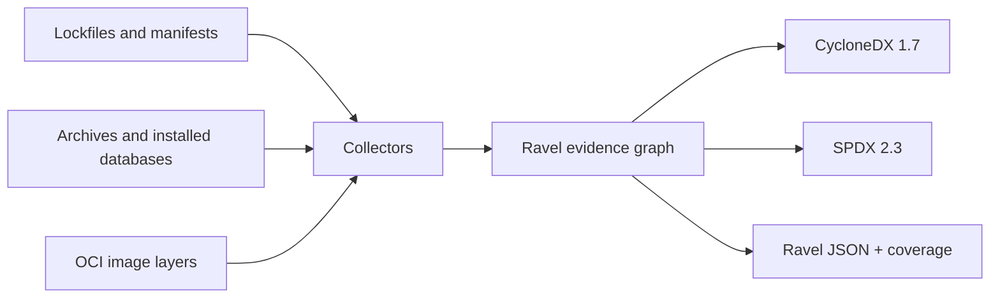

# Ravel

**SBOM generation grounded in evidence from projects, archives, and container images.**

[](https://github.com/Pirikara/Ravel/actions/workflows/ci.yml)

Ravel is a command-line tool under active development, written in Go. It turns local lockfiles, package metadata, archives, and OCI images into a software bill of materials (SBOM). Every package and relationship can carry evidence, while a separate coverage report explains what the input could not establish.

Ravel distinguishes **package identity**, **distribution origin**, and **development repository**. A repository URL in a lockfile is a declaration; it is not proof that a package was downloaded from that URL. When an input cannot establish a claim, Ravel leaves it open instead of inventing one.

- **Outputs:** CycloneDX 1.7 JSON, SPDX 2.3 JSON, Ravel JSON, and a coverage report.
- **Inputs:** common application lockfiles, selected package manager results, package archives, installed OS databases, and local OCI or Docker save archives.
- **Default behavior:** local, static analysis without package manager execution or network access.
- **Inspection:** `explain` a package, `diff` two scans, `merge` scans, or explicitly `enrich` development repository candidates.

> Ravel is under active development. Read the coverage report before treating an SBOM as complete for your use case.

## Contents

- [Get started](#get-started)
- [How Ravel represents evidence](#how-ravel-represents-evidence)
- [Supported inputs](#supported-inputs)
- [Scan workflows](#scan-workflows)
- [Coverage and output formats](#coverage-and-output-formats)
- [Optional resolution and enrichment](#optional-resolution-and-enrichment)
- [Current limits](#current-limits)
- [Development](#development)

## Get started

Ravel currently builds from source and requires **Go 1.27 or newer**.

```sh
go build -o ravel ./cmd/ravel
./ravel scan path/to/project --output sbom.cdx.json --report coverage.json
```

The scan command produces a CycloneDX SBOM and a separate JSON coverage report. To retain evidence and conditional dependency edges for inspection, also write Ravel JSON:

```sh
./ravel scan path/to/project --format ravel-json --output scan.ravel.json
./ravel explain 'package-name' --input scan.ravel.json
```

`scan` accepts either a project directory or a supported file. It writes CycloneDX JSON to stdout unless `--output` is given. Progress and errors go to stderr. Run `./ravel` without arguments for command syntax.

### A small example

The repository includes an RPM database with two test packages. Scan it and inspect the report:

```sh
./ravel scan testdata/fixtures/rpm-sqlite-basic \
  --manager rpm \
  --output rpm.cdx.json \
  --report rpm.coverage.json
```

The report records two packages and explains why the graph and origin are partial:

```json
{
  "manager": "rpm",
  "graphState": "partial",
  "originState": "partial",
  "packages": 2,
  "edges": 3,
  "issues": [
    {"code": "missing_source", "name": "RPM database"},
    {"code": "rpm_dependency_flags_unavailable", "name": "ravel-fixture-consumer"}
  ],
  "outputFormat": "cyclonedx-json",
  "outputLosses": [
    {"code": "conditional_edges_omitted", "count": 1},
    {"code": "edge_kinds_omitted", "count": 2},
    {"code": "evidence_records_omitted", "count": 5},
    {"code": "source_paths_omitted", "count": 1},
    {"code": "coverage_issues_omitted", "count": 2}
  ]
}
```

The three Ravel edges include two installed-package edges and one conditional dependency. CycloneDX omits that dependency because its RPM version constraint cannot be verified from the current parser output.

## How Ravel represents evidence



A Ravel JSON document keeps these records separate:

| Record | What it means |
| --- | --- |
| **Component** | One observed package occurrence, with its name, version, context, and evidence. |
| **Edge** | A relationship backed by evidence. A `condition` marks a relationship that depends on an unselected target, range, marker, or other unresolved choice. |
| **Origin** | A distribution location or source declaration, with its evidence and status. |
| **Development** | A candidate source repository. It is distinct from the place that distributed the package. |
| **Coverage** | Package and edge counts, graph and origin states, and specific issues. |

Ravel records hashes for observed archive bytes and checks available lockfile integrity data. It removes credentials, URL queries, and fragments before storing URLs. A default registry Package URL (PURL) is omitted when that registry cannot be established from the input.

CycloneDX and SPDX exports include only dependency edges that are unconditional for the scanned scope. **Ravel JSON retains conditional edges and their evidence**. The coverage report lists any information lost in the requested export separately from scan issues.

## Supported inputs

The table describes inputs Ravel reads today. A listed format does not imply complete dependency or origin coverage; the report describes each scan's actual scope.

| Ecosystem | Inputs | Notes |
| --- | --- | --- |
| Ruby | `Gemfile.lock`; `.gem` archives | GEM, GIT, and PATH sources; archive metadata and SHA-256. |
| JavaScript | npm lockfiles v1–v4; pnpm v6/v9; Yarn Classic and Berry; Bun text `bun.lock` v0–v2; npm `.tgz` archives | Package locations, dependency edges, and conditions where the format permits. |
| Deno | `deno.lock` v4/v5, `deno.json` / `deno.jsonc`, local import maps, JS/TS imports | Discovers static imports, re-exports, and literal dynamic imports as entry points. |
| Python | `uv.lock` v1; `pylock.toml` 1.0; Poetry, Pipenv, PDM, and pinned requirements; `.whl` archives | Keeps markers, extras, groups, and unresolved choices conditional. |
| .NET | NuGet `packages.lock.json`, `project.assets.json`, `.nupkg` archives | Keeps target framework choices. |
| Swift | `Package.resolved` v1–v3 | Static pins do not establish package dependency edges. |
| Java | Maven `pom.xml` and dependency tree JSON; Gradle lockfiles; JAR/WAR archives | Includes declared Maven modules and nested JARs when identifiable. |
| Go | `vendor/modules.txt` with `go.mod` | An optional `go list` resolver handles projects without usable vendor data. |
| Rust | Cargo.lock v3/v4 | An optional `cargo metadata` resolver supplies a selected host graph. |
| PHP | `composer.lock` | Source and distribution URLs remain separate. |
| Apple | CocoaPods `Podfile.lock` | Keeps subspec and target choices. |
| Dart/Flutter | `pubspec.lock` | Hosted, Git, path, and SDK sources are distinguished. |

### Installed systems and images

| Input | Current scope |
| --- | --- |
| Debian rootfs | Installed packages from `var/lib/dpkg/status`; declared `Depends` and `Pre-Depends`. |
| Alpine rootfs | APK text v2 `lib/apk/db/installed`; installed names and supported virtual providers. |
| RPM rootfs | SQLite `rpmdb.sqlite`, NDB `Packages.db`, and Berkeley DB `Packages`; name, epoch, version, release, architecture, and conditional capability links. |
| OCI image | Local OCI layout or OCI/Docker save tar archive, including gzip-compressed tar; final Debian, APK, or RPM database and JAR/WAR files after layer whiteouts. |
| Installed Python in OCI | `.dist-info/METADATA` records and `Requires-Dist` links when identifiable. |
| Installed Node in OCI | Conventional `node_modules/*/package.json` records and dependency links when identifiable. |
| Java archives in OCI | JAR/WAR files and identifiable nested JARs, with archive hashes and embedded Maven metadata. |

OCI scans verify available descriptor SHA-256 hashes and uncompressed layer DiffIDs. A multi-image layout requires `--platform os/architecture[/variant]`. Legacy Docker save archives must contain one image. Ravel reads local image data; it does not pull images.

## Scan workflows

### One project or a polyglot tree

```sh
./ravel scan path/to/project --output sbom.cdx.json --report coverage.json
./ravel scan path/to/polyglot-project --all --recursive --output combined.cdx.json
```

`--all` combines static inputs in one directory. `--recursive` also scans subprojects while skipping generated directories such as `.git`, `node_modules`, and `vendor`. Archives are not automatically discovered. If multiple JavaScript lockfiles coexist, Ravel uses `package.json`'s `packageManager` field; otherwise select a manager explicitly.

### A package archive or installed system

```sh
./ravel scan path/to/app.jar --output app.cdx.json
./ravel scan path/to/package.whl --output wheel.cdx.json
./ravel scan path/to/package.nupkg --output nuget.cdx.json
./ravel scan path/to/debian-rootfs --manager dpkg --output debian.cdx.json
./ravel scan path/to/alpine-rootfs --manager apk --output alpine.cdx.json
./ravel scan path/to/fedora-rootfs --manager rpm --output fedora.cdx.json
```

`.war`, `.gem`, and npm `.tgz` archives are also accepted. An archive proves the bytes Ravel read; it does not by itself prove which registry supplied them.

### A container image

```sh
docker save --output image.docker.tar image:tag
./ravel scan image.docker.tar --platform linux/amd64 \
  --output image.cdx.json --report image.coverage.json
```

You can also scan an OCI layout directory, a `.oci.tar` archive, or a gzip-compressed `.docker.tar.gz` / `.oci.tar.gz` archive. For a generic `.tar` or `.tar.gz` file, specify `--manager oci`.

### Inspect, compare, and combine

```sh
./ravel scan path/to/project --format ravel-json --output project.ravel.json
./ravel explain 'package-name' --input project.ravel.json
./ravel diff before.ravel.json after.ravel.json --format json
./ravel merge --name my-app --format cyclonedx-json \
  --output combined.cdx.json npm.ravel.json cargo.ravel.json
```

`explain` accepts a package name, PURL, or component ID. If multiple occurrences share a name, use the component ID. `merge` takes at least two Ravel JSON inputs, preserves distinct occurrences, and rejects duplicate input scopes.

## Coverage and output formats

| Output | Use it for | Retained detail |
| --- | --- | --- |
| `cyclonedx-json` (default) | A standard CycloneDX 1.7 SBOM | Packages and unconditional dependencies; some provenance details as supported by the format. |
| `spdx-json` | A standard SPDX 2.3 SBOM | Packages, PURLs when established, and unconditional dependencies. |
| `ravel-json` | Investigation, `explain`, `diff`, `merge`, and `enrich` | Evidence, conditional edges, origin and development records, and scan coverage. |
| `--report FILE` | Checking the result of any output format | Scan issues and `outputLosses` for the chosen format. |

`graphState` and `originState` describe the scanned scope:

- `complete_for_scope`: Ravel found no known gap for that dimension **within the input's defined scope**.
- `partial`: Ravel found packages or relationships but also recorded a known gap.
- `unknown`: The input did not establish a graph or origin for that dimension.

`--strict` writes the requested output and then exits with code **3** if any scan coverage issue remains. A normal successful scan exits **0**; scan or input failures exit **1**, and invalid usage exits **2**. `outputLosses` describe conversion to the chosen format and do not by themselves trigger strict mode.

## Optional resolution and enrichment

A normal `scan` does not execute a package manager. For **Go modules, Cargo, Maven, Gradle, or SwiftPM**, resolution is opt-in:

```sh
./ravel scan path/to/cargo/project --manager cargo \
  --resolve --allow-exec --network deny
./ravel scan path/to/gradle/project --manager gradle \
  --resolve --allow-exec --configuration runtimeClasspath --network deny
```

`--network deny` is the default for resolver commands. Package manager offline flags do **not** isolate build scripts or plugins at the operating system level. Use `--network allow` only when you intend to permit the resolver to fetch data.

`enrich` is a separate, explicit network operation. It reads Ravel JSON and adds development repository **candidates** from matched registry metadata without changing package identities, distribution origins, or dependency edges:

```sh
./ravel enrich scan.ravel.json --ecosystem npm --network allow \
  --output enriched.ravel.json
```

The supported ecosystems are `rubygems`, `npm`, and `pypi`. Ravel checks the package name and version plus the applicable platform, tarball URL, or distribution digest before accepting a repository candidate. `--registry HTTPS_URL` selects an API origin; `--max-requests N` lowers the default 1,000-request limit. Requests use HTTPS, bounded responses and deadlines, and no redirects or credentials. Failed lookups and mismatches appear in coverage.

## Current limits

- **Static data has boundaries.** SwiftPM pins and Gradle lockfiles do not contain complete dependency graphs. Go vendor data and Pub lockfiles do not establish every transitive edge. Maven POMs are not effective POMs, and Poetry/Composer manifest freshness is not verified.
- **Some choices remain conditional.** Python markers and extras, npm peers, NuGet target frameworks, Cargo features and targets, and CocoaPods targets can require an environment or target selection. These edges remain in Ravel JSON and are omitted from unconditional standard-format dependency lists.
- **Installed OS databases do not prove repository origin.** Debian, APK, and RPM scans leave PURL and origin unset when the database cannot establish them. RPM dependency version flags are not exposed by the current parser, so its dependency edges stay conditional. APK binary v3 databases are not supported.
- **OCI language coverage is still partial.** Installed Python dist-info, conventional Node package manifests, and JAR/WAR files are read. Other language packages and pnpm's content store are not yet inventoried from image files. Symlinked Node packages and Java archives are not followed. Java archive inspection is capped at 128 MiB per file, 256 MiB per image, and 1,000 files; oversized files appear in coverage.
- **Some input versions are unsupported.** Binary `bun.lockb` is rejected; create a text `bun.lock` with Bun before scanning. Unknown lockfile versions and unparsed features are reported or rejected rather than silently guessed.

## Development

```sh
go test ./... -count=1
go vet ./...
```

The integration suite scans 183 supported fixture directories and 25 unsupported format cases. It validates CycloneDX 1.7 and SPDX 2.3 against their JSON Schemas and checks package counts, dependency edges, provenance, URL redaction, conditional relationships, and coverage. Fixtures include generated npm, pnpm, Yarn, Bundler, Composer, Bun, Deno, uv, and dotnet lockfiles; Debian, APK, and RPM installed databases; and package archives.

The real Maven resolver tests are opt-in:

```sh
RAVEL_TEST_REAL_MAVEN=1 go test ./integration \
  -run 'TestMavenResolverWithReal(Reactor|Maven)' -count=1
```

Registry enrichment tests use local TLS servers and saved version responses. New collectors should include representative real-format fixtures and assertions about identity, graph, origin, and output loss.

See [third-party notices](THIRD_PARTY_NOTICES.md) for licenses of the RPM database reader's Go dependencies.
