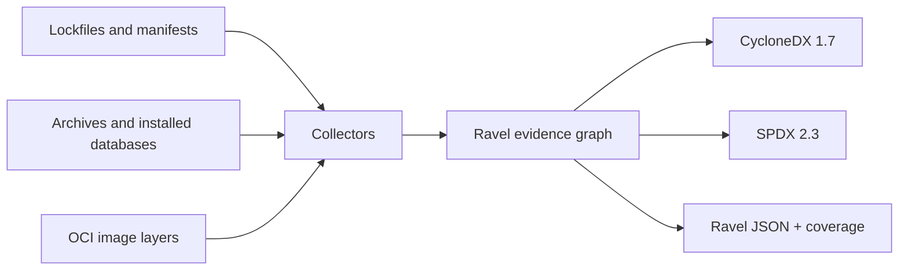

# Evidence and provenance

A Ravel JSON document keeps these records separate:

| Record | What it means |
| --- | --- |
| **Component** | One observed package occurrence, with its name, version, context, and evidence. |
| **Edge** | A relationship backed by evidence. A `condition` marks a relationship that depends on an unselected target, range, marker, or other unresolved choice. |
| **Origin** | A distribution location or source declaration, with its evidence and status. |
| **Development** | A candidate source repository. It is distinct from the place that distributed the package. |
| **Coverage** | Package and edge counts, graph and origin states, and specific issues. |

Ravel records hashes for observed archive bytes and checks available lockfile integrity data. It removes credentials, URL queries, and fragments before storing URLs. A default registry Package URL (PURL) is omitted when that registry cannot be established from the input.

CycloneDX and SPDX exports include only dependency edges that are unconditional for the scanned scope. **Ravel JSON retains conditional edges and their evidence**. The coverage report lists any information lost in the requested export separately from scan issues.
